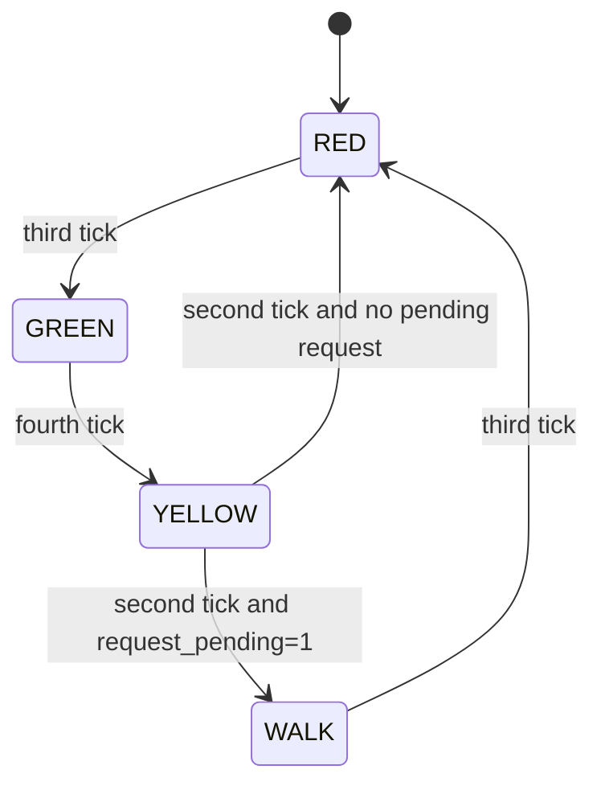

# Basys 3 Pedestrian Event-Capture FSM

A SystemVerilog FPGA project for the **Digilent Basys 3** that extends a timed Moore FSM with asynchronous button conditioning, a sticky pending-request register, request/service priority logic, and a `WALK` state.

> This is an educational FPGA controller used to study event capture and FSM coordination. It is **not** a controller for real traffic infrastructure.

## What this project demonstrates

- One-clock-domain synchronous design at 100 MHz
- Parameterized one-second tick generation
- 2-FF synchronization, debounce, and rising-edge detection for a physical pushbutton
- Converting a short event pulse into persistent state with a **pending-request register**
- Separating **event capture** from **event service**
- Explicit priority when `request_pulse` and `service` occur together
- Four-state Moore FSM with timed transitions
- Simulation of baseline and corner cases
- Synthesis resource prediction versus actual implementation
- XDC constraints, implementation timing, and Basys 3 hardware verification


## Controller behavior



The Moore outputs are:

| State | red_led | green_led | yellow_led | walk_led |
|---|---:|---:|---:|---:|
| RED | 1 | 0 | 0 | 0 |
| GREEN | 0 | 1 | 0 | 0 |
| YELLOW | 0 | 0 | 1 | 0 |
| WALK | 1 | 0 | 0 | 1 |

A request received during `GREEN`, `YELLOW`, or `WALK` can be remembered by `request_pending`. A request accepted at the end of `YELLOW` produces `service=1` and enters `WALK`. If a **new** `request_pulse` occurs at the same time as `service`, the new request has priority and remains pending for a later cycle.

## Module hierarchy

```text
pedestrian_fsm_top
├── BUTTON_PULSE : button_conditioner
│   ├── SYNC : sync_2ff
│   ├── DEBOUNCE : debounce
│   └── EDGE_DETECTOR : edge_detect
├── TICK_GENERATOR : tick_generator
└── FSM : pedestrian_fsm_controller
```

## Key RTL idea: sticky request flag

```systemverilog
always_ff @(posedge clk) begin
    if (rst)
        request_pending <= 1'b0;
    else if (request_pulse)
        request_pending <= 1'b1;
    else if (service)
        request_pending <= 1'b0;
end
```

Priority is intentional: `request_pulse` is checked before `service`, so a new event is not discarded when an older event is acknowledged on the same clock edge.

## Simulation parameters

The synthesizable defaults target the Basys 3:

```systemverilog
CLK_FREQ_HZ   = 100_000_000
STABLE_CYCLES = 1_000_000
```

The integration testbench accelerates both functions:

```systemverilog
CLK_FREQ_HZ   = 4
STABLE_CYCLES = 5
```

This keeps the same RTL architecture while making waveforms practical to inspect.

## Verified simulation scenarios

1. No pedestrian request: `RED -> GREEN -> YELLOW -> RED`; `WALK` never activates.
2. Request during `GREEN`: the one-cycle event becomes `request_pending=1`, survives through `YELLOW`, and is serviced by entering `WALK`.
3. Request during `WALK`: the current WALK interval is not extended; the new request remains pending and is serviced after the next `RED -> GREEN -> YELLOW` sequence.
4. Simultaneous `request_pulse` and `service`: the FSM enters `WALK`, while `request_pending` remains `1` because the new request wins the priority decision.

Evidence screenshots are in [`docs/screenshots`](docs/screenshots/).

## Synthesis result

Before synthesis, a 59-register estimate assumed one-hot encoding for four FSM states. Vivado instead retained the RTL's 2-bit state encoding, producing **57 registers** total.

| Hierarchy | Slice LUTs | Slice Registers |
|---|---:|---:|
| `BUTTON_PULSE` | 19 | 24 |
| `FSM` | 8 | 5 |
| `TICK_GENERATOR` | 21 | 28 |
| **Total** | **48** | **57** |

The FSM's five registers correspond to two state bits, two elapsed-counter bits, and one pending-request bit.

## Implementation timing

With a 10 ns (100 MHz) clock constraint, the implemented design reported:

- Setup WNS: **+5.980 ns**
- Setup TNS: **0.000 ns**
- Hold WHS: **+0.185 ns**
- Hold THS: **0.000 ns**
- Worst pulse-width slack: **+4.500 ns**
- Failing endpoints: **0**

Vivado reported that all user-specified timing constraints were met.

## Basys 3 pin mapping

| Signal | Board resource | Pin |
|---|---|---|
| `clk` | 100 MHz oscillator | W5 |
| `rst` | BTNC | U18 |
| `pedestrian_button_async` | BTNR | T17 |
| `red_led` | LD0 | U16 |
| `green_led` | LD1 | E19 |
| `yellow_led` | LD2 | U19 |
| `walk_led` | LD3 | V19 |

## Hardware verification

The physical Basys 3 tests passed for normal cycling, a request during GREEN, a request during WALK, and reset behavior. During `WALK`, both the vehicle red indicator (`LD0`) and pedestrian walk indicator (`LD3`) are illuminated.

## Repository structure

```text
.
├── README.md
├── .gitignore
├── rtl/
│   ├── sync_2ff.sv
│   ├── debounce.sv
│   ├── edge_detect.sv
│   ├── button_conditioner.sv
│   ├── tick_generator.sv
│   ├── pedestrian_fsm_controller.sv
│   └── pedestrian_fsm_top.sv
├── sim/
│   ├── pedestrian_fsm_top_tb.sv
│   └── pedestrian_fsm_controller_corner_tb.sv
├── constraints/
│   └── pedestrian_fsm_basys3.xdc
└── docs/
    ├── diagrams/
    └── screenshots/
```

## Recommended Vivado flow

Create an RTL project for the Basys 3 / `xc7a35tcpg236-1`, add the files under `rtl/`, set `pedestrian_fsm_top` as the design top, add the testbench under `sim/`, and add the XDC under `constraints/`. Use the accelerated parameter overrides only in simulation; keep the synthesizable defaults for hardware.
